<div align="center">

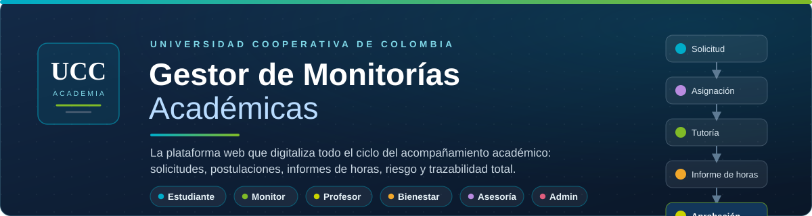

**Plataforma web Full Stack que digitaliza el ciclo completo del acompañamiento académico universitario.**

[](https://www.python.org/)
[](https://fastapi.tiangolo.com/)
[](https://mariadb.org/)
[](https://developer.mozilla.org/es/docs/Web/JavaScript)
[](https://getbootstrap.com/)
[](#-calidad-y-verificación)
[](#-licencia-y-créditos)

`Estudiante` · `Monitor` · `Profesor` · `Bienestar Universitario` · `Docente de Asesoría` · `Administrador`

[El problema](#-el-problema) &nbsp;|&nbsp; [La solución](#-la-solución) &nbsp;|&nbsp; [Historias de usuario](#-historias-de-usuario) &nbsp;|&nbsp; [Casos de uso](#-casos-de-uso) &nbsp;|&nbsp; [Arquitectura](#%EF%B8%8F-arquitectura) &nbsp;|&nbsp; [UML](#%EF%B8%8F-modelado-uml) &nbsp;|&nbsp; [Instalación](#-instalación) &nbsp;|&nbsp; [API](#-api) &nbsp;|&nbsp; [Seguridad](#%EF%B8%8F-seguridad)

</div>

---

## 🎯 El problema

En los programas académicos, el servicio de monitorías sigue gestionándose con herramientas que no fueron
hechas para ello: grupos de WhatsApp, planillas de Excel, correos sueltos y reportes en papel. El resultado
es un proceso que funciona a duras penas y con tres costos reales:

- **Solicitudes que se pierden.** El estudiante pide ayuda por cualquier canal y no queda registro de
  quién la pidió, cuándo ni para qué; la respuesta puede demorarse días o simplemente no llega.
- **Horas que nadie valida a tiempo.** El monitor atiende sesiones, pero el reporte de horas depende de
  planillas que viajan de manos en manos entre monitor, profesor y Bienestar: sin fechas, sin firmas y con
  discrepancias que solo se descubren a fin de periodo.
- **Estudiantes en riesgo sin seguimiento.** El profesor detecta a quien reprueba, pero la alerta se queda
  en su mensaje; Asesoría no la ve de forma oportuna y nadie confirma que un monitor quedó asignado al caso.

A esto se suma que **nadie puede responder la pregunta simple**: *¿quién hizo qué, cuándo y sobre qué
registro?* — sobre todo si un administrador toca el sistema en nombre de alguien más.

## 💡 La solución

**Gestor de Monitorías Académicas UCC** es una aplicación web autónoma que convierte ese proceso disperso
en **un flujo único, trazable y auditado**, con un rol y módulos propios para cada actor:

- **Un ciclo de vida completo:** el estudiante solicita una monitoría → Asesoría la responde → el monitor
  programa la tutoría → registra su informe de horas → el profesor lo valida → Bienestar da la aprobación
  final. Cada paso notifica a los siguientes involucrados.
- **Gestión de riesgo con insumo real:** el profesor publica listas de estudiantes en riesgo desde sus
  cursos; Asesoría las revisa y asigna un monitor concreto a cada caso, y todo queda señalado en el calendario.
- **Postulaciones formalizadas:** el estudiante aspira a monitor de una asignatura con su horario por
  bloques; Bienestar verifica promedio e historial y habilita (o rechaza) con motivo.
- **Reportes oficiales tabulares:** horas por monitor, monitorías por asignatura y solicitudes por estado,
  con filtros en vivo y exportación a CSV (compatible con Excel) y PDF vía impresión.
- **Transparencia institucional:** el administrador crea usuarios y materias, revoca accesos, restablece
  claves y puede **operar como cualquier rol en un modo de supervisión** donde cada acción queda firmada en
  la auditoría con el actor real y el objetivo.

La interfaz es una **SPA en JavaScript vanilla** con **Bootstrap 5 y CSS propio**, sin dependencias en
línea (todo se sirve localmente), pensada para correr en el equipo de la universidad con una base de
datos MySQL/MariaDB propia.

## 👥 Historias de usuario

El alcance se construyó sobre **14 historias de usuario** que cubren a los seis actores. Cada una tiene un
criterio de aceptación verificable en la plataforma y una prueba automatizada que la respalda.

| Código | Actor | Historia | Criterio de aceptación |
|:---:|:---|:---|:---|
| **HU01** | Estudiante | Solicitar monitoría con tema y horario | Formulario válido → queda pendiente; Asesoría es notificada |
| **HU02** | Estudiante | Postularse como monitor de una asignatura | Disponibilidad por bloques; queda pendiente de Bienestar |
| **HU03** | Monitor | Programar tutorías a asignados | Valida horario, tope semanal y traslapes |
| **HU04** | Monitor | Registrar informe de horas | Solo tutoría realizada sin informe; horas en medias horas |
| **HU05** | Profesor | Reportar lista de estudiantes en riesgo | Curso propio; motivos obligatorios; llega a Asesoría |
| **HU06** | Profesor | Validar informes de sus tutorías | Aprueba o rechaza con observación |
| **HU07** | Bienestar | Aprobar postulaciones de monitor | Verifica promedio e historial; habilita o rechaza |
| **HU08** | Bienestar | Aprobación final de horas | Solo informes ya validados por el profesor |
| **HU09** | Asesoría | Asignar monitor a caso en riesgo | Monitor activo con disponibilidad; notifica a todos |
| **HU10** | Asesoría | Responder solicitudes de monitoría | Acepta o rechaza con respuesta visible al estudiante |
| **HU11** | Admin | Crear usuarios de cualquier rol | Correo único; entrega clave temporal una sola vez |
| **HU12** | Admin | Crear materias y asignar profesor | Código único; profesor existente |
| **HU13** | Admin | Supervisar funciones de otro rol | Todo acto queda en auditoría |
| **HU14** | Todos | Ver reportes y exportar CSV/PDF | Filtros y búsqueda; CSV compatible con Excel |

<div align="center">
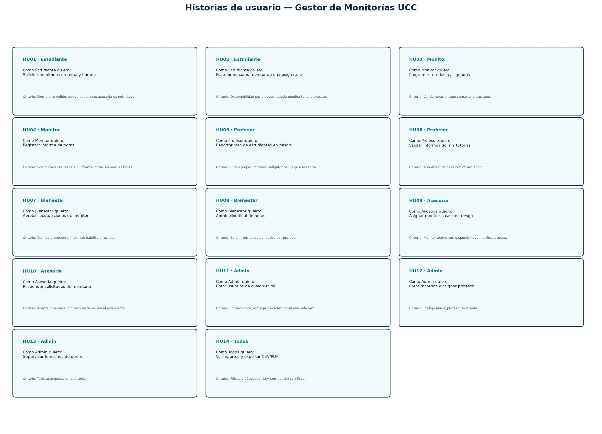
</div>

## 🧩 Casos de uso

El modelo funcional se especificó en **32 casos de uso (UC01–UC76)** agrupados por paquete: sesión y base,
estudiante, monitor, profesor, Bienestar, Asesoría, reportes y administración total. Las relaciones
`<<include>>` y `<<notify>>` muestran los flujos reales: una solicitud avisada a Asesoría, una postulación
que pasa por aprobación y habilita el monitor, y una lista de riesgo que derivó en asignación, tutoría,
informe y validación.

<div align="center">
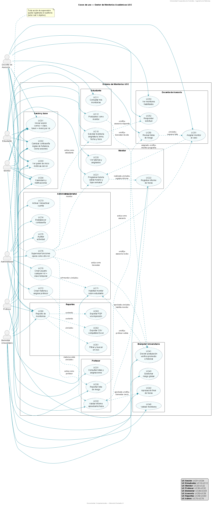
</div>

## 🧰 Tecnologías

| Capa | Tecnología | Rol en el sistema |
|:---|:---|:---|
| Backend | **Python 3.13 + FastAPI + Uvicorn** | Dispatcher único `POST /api`, middlewares y rutas para reportes |
| Base de datos | **MySQL/MariaDB (PyMySQL)** | 18 tablas normalizadas con PK/FK, transacciones y migración declarativa |
| Seguridad | **PyJWT + Argon2** | Access token corto + refresh rotativo en cookie `HttpOnly`; hashes de contraseña Argon2 |
| Frontend | **HTML5 semántico, CSS propio, JS ES6 y Bootstrap 5** | SPA por módulos, accesible (roles, focus, `aria-*`) y sin dependencias remotas |
| Calendario | **FullCalendar** | Agenda de tutorías y sesiones por usuario |
| Pruebas | **pytest + httpx** | Suite de 77 pruebas: unitarias y extremo a extremo sobre la base real |
| Multimedia | **MediaDevices (`getUserMedia`)** | Toma de foto de perfil desde la cámara (contexto local) |

## 🏗️ Arquitectura

Arquitectura **MVC adaptada** con un patrón de repositorio como única capa de acceso a datos:

- **Vista (SPA):** `frontend/` — módulos JavaScript por funcionalidad que se registran como
  `window.vistas_ucc[clave]`; el menú que el backend entrega por rol determina qué vista se carga.
- **Controlador:** `backend/app/api.py` — un dispatcher único que valida la acción, el token de acceso y el
  rol, y delega en módulos por rol (`modulos/estudiante.py`, `modulos/monitor.py`, …). Los errores de
  negocio viajan en una jerarquía de excepciones con código HTTP propio.
- **Modelo:** `backend/app/esquema.sql` (18 tablas) + `base_datos.py` (consultas 100 % parametrizadas) +
  `repositorio.py`, donde un repositorio genérico con **lista blanca de columnas** impide que cualquier
  módulo actualice campos sensibles.

<div align="center">
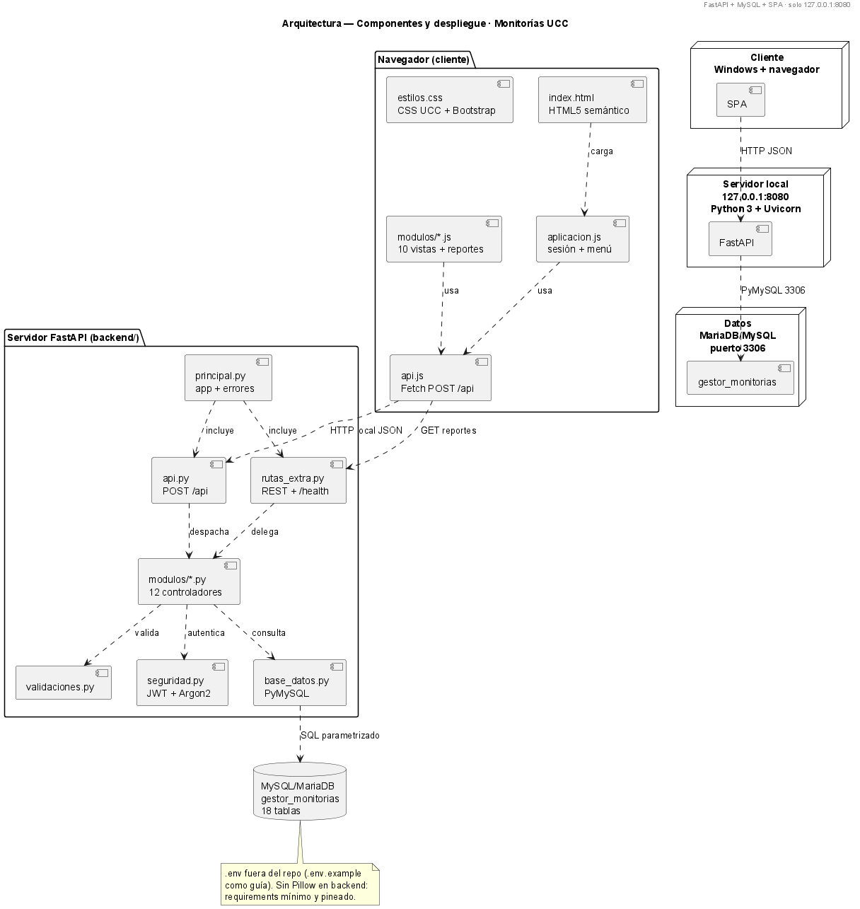
</div>

## 📐 Modelado UML

### Clases

Diseño orientado a objetos de las entidades del dominio junto a los controladores por rol y el repositorio
genérico con su lista blanca de columnas actualizables.

<div align="center">
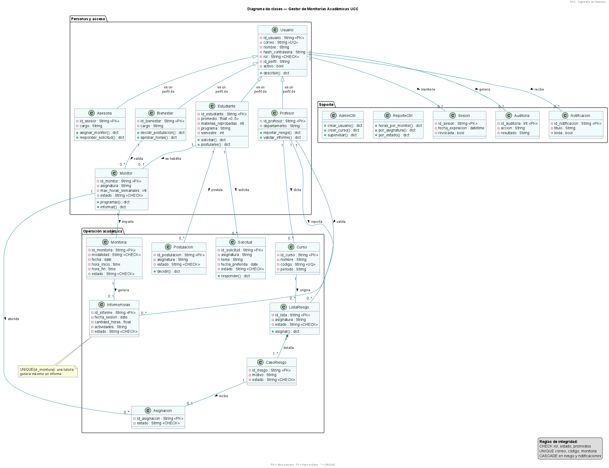
</div>

### Entidad-Relación y modelo relacional

Modelo conceptual (MER) y su traducción física en el `esquema.sql` de 18 tablas con integridad referencial.

<div align="center">
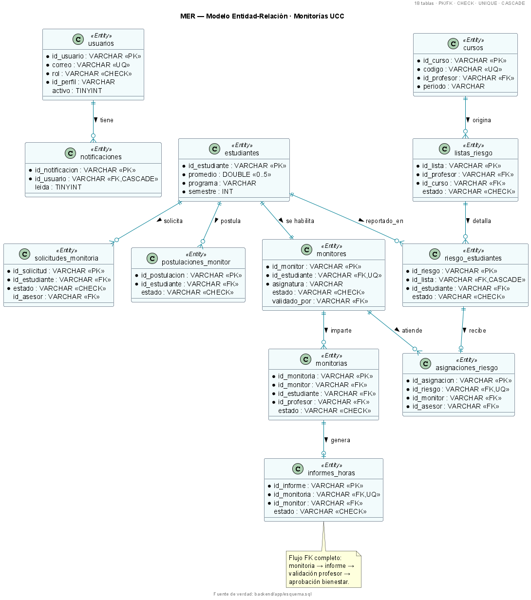
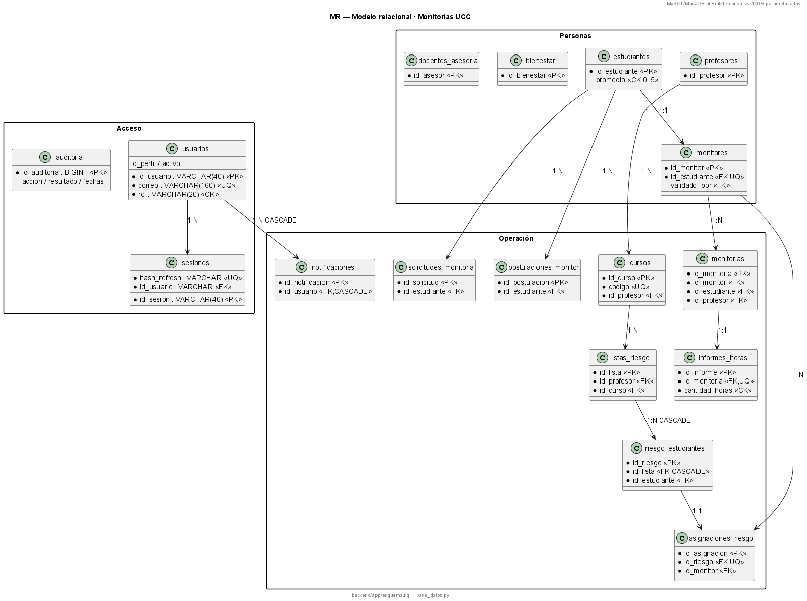
</div>

### Secuencias de los flujos principales

| Inicio de sesión con refresh rotativo | Solicitud de monitoría (UC10 → UC52) |
|:---:|:---:|
| 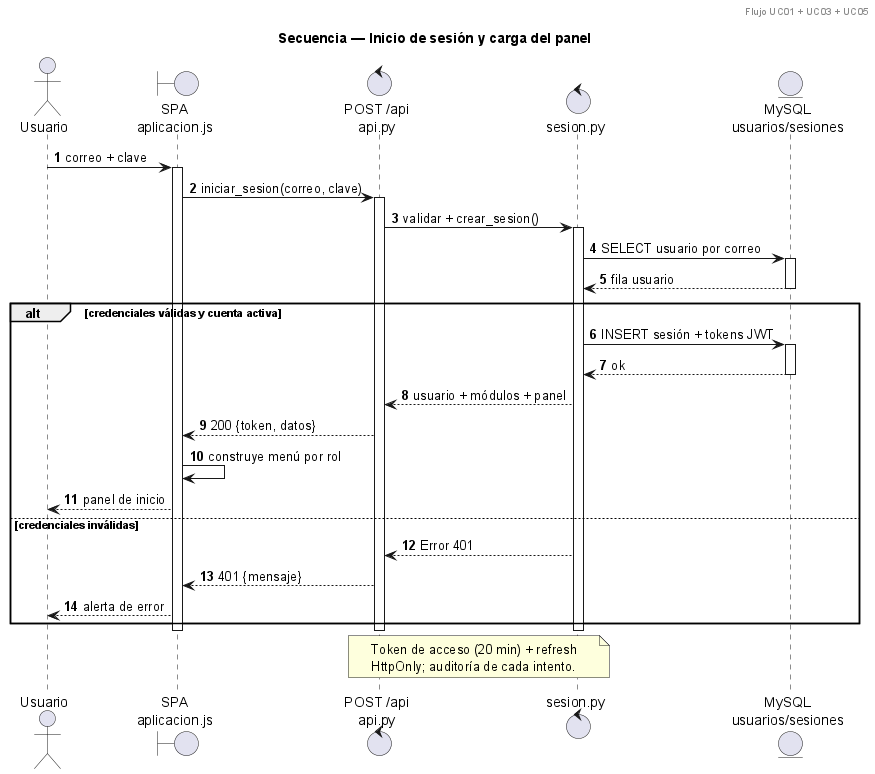 | 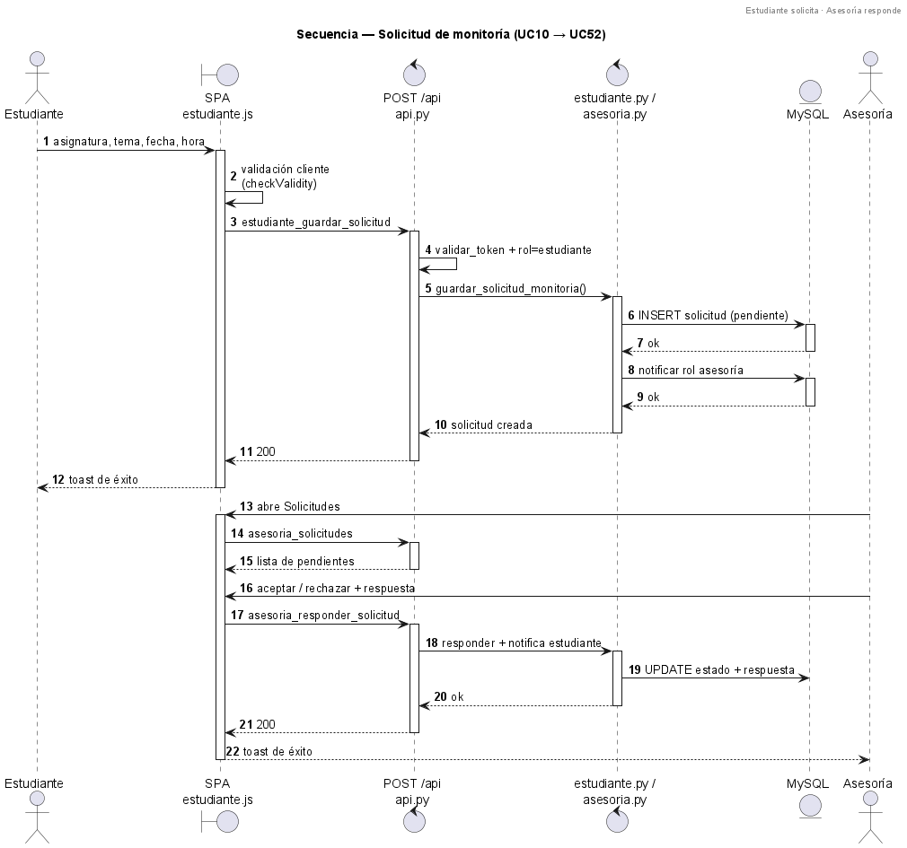 |

| Postulación y habilitación de monitor (UC12 → UC41 → UC71) | Informe de horas (UC22 → UC32 → UC42) |
|:---:|:---:|
| 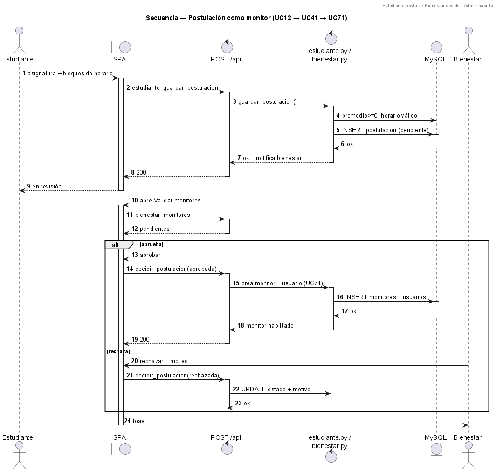 | 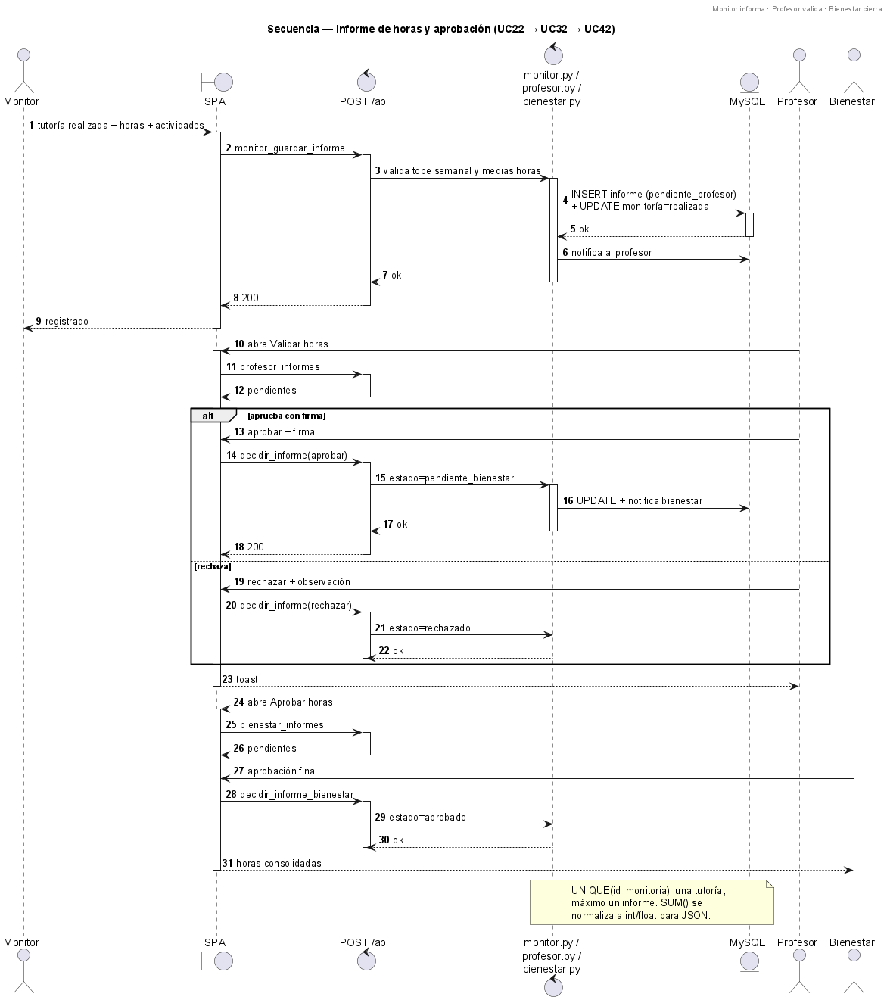 |

| Riesgo: reporte, asignación y seguimiento (UC30 → UC51 → UC21) | Ciclo de vida de la monitoría (actividad) |
|:---:|:---:|
| 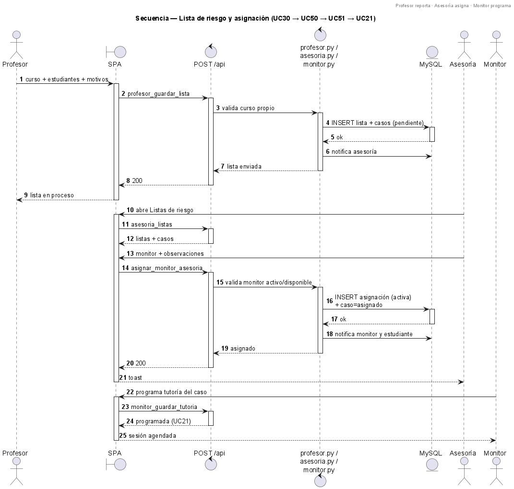 | 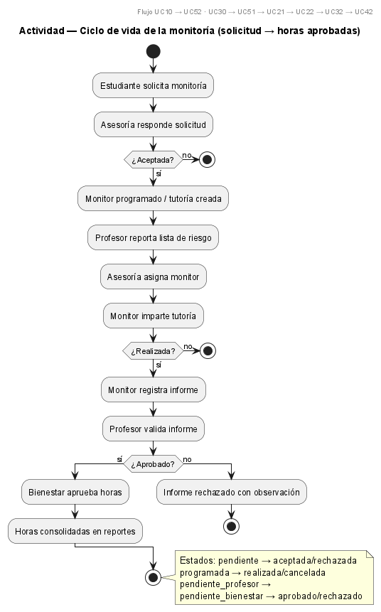 |

## 📁 Estructura del repositorio

```text
├── iniciar.bat                  # Arranque guiado: BD + suite de pruebas + servidor
├── credenciales.txt             # Credenciales fijas de demostración (1 por rol)
├── LICENSE                      # Licencia MIT (ES/EN)
│
├── backend/
│   ├── iniciar.py               # Servidor (Uvicorn) en 127.0.0.1:8080
│   ├── preparar_bd.py           # Crear/recrear BD + migración declarativa (--reset)
│   ├── requirements.txt         # Dependencias versionadas (app + pruebas)
│   ├── .env.example             # Plantilla de configuración (DB_*, JWT_SECRETO)
│   ├── app/
│   │   ├── api.py               # Dispatcher POST /api (roles, auditoría, 429)
│   │   ├── principal.py         # Aplicación FastAPI, middlewares y páginas estáticas
│   │   ├── rutas_extra.py       # GET /health y GET /api/reportes/*
│   │   ├── esquema.sql          # 18 tablas PK/FK
│   │   ├── base_datos.py        # Conexión parametrizada + migración declarativa
│   │   ├── repositorio.py       # Repositorio genérico con lista blanca de columnas
│   │   ├── seguridad.py         # JWT, Argon2, sesiones con rotación de refresh
│   │   ├── validaciones.py      # Reglas de negocio compartidas
│   │   ├── errores.py           # Jerarquía de errores con código HTTP por tipo
│   │   ├── auditoria.py         # Pista de auditoría por acción
│   │   ├── datos_iniciales.py   # Semilla: 24 cuentas demo y calendario poblado
│   │   └── modulos/             # Controladores por rol + sesión, perfil, registro…
│   └── tests/                   # 77 pruebas: unitarias + extremo a extremo (TestClient)
│
├── frontend/
│   ├── index.html               # Shell de la SPA con accesibilidad semántica
│   ├── css/estilos.css          # Sistema de diseño institucional UCC
│   ├── assets/                  # Bootstrap, FullCalendar, iconos y logos (offline)
│   └── js/                      # api.js, aplicacion.js, utilidades.js y módulos/vistas
│
└── docs/
    ├── informe_n5.md            # Informe académico del proyecto
    └── diagramas/               # UML, MER, MR, secuencias, actividad (PNG + PlantUML)
```

## 🚀 Instalación

**Requisitos:** Windows 10/11 · Python 3.10+ · MySQL o MariaDB en ejecución local.

```bat
1.  git clone https://github.com/MartinEscudero771/sistema-gestor-monitorias-ucc.git
2.  copy backend\.env.example backend\.env   y complete DB_* y JWT_SECRETO (32+ caracteres)
3.  iniciar.bat
```

`iniciar.bat` crea el entorno virtual, instala dependencias, prepara la base de datos
(`gestor_monitorias`), ejecuta la **suite de 77 pruebas** y abre `http://127.0.0.1:8080`.
Con la base vacía se carga una **semilla de demostración**: 24 cuentas, 7 cursos, monitorías pasadas y
futuras, listas de riesgo, solicitudes, notificaciones y un calendario poblado desde el primer día.

| Modo | Comando | Qué hace |
|:---|:---|:---|
| Demo limpia de un tirón | `iniciar.bat --reset` | Recrea esquema + semilla con **credenciales fijas** |
| Arranque sin pruebas | `iniciar.bat --sin-tests` | Salta la suite y abre el servidor |

Instalación manual (sin `iniciar.bat`):

```bat
py -3 -m venv .venv
.\.venv\Scripts\python -m pip install -r backend\requirements.txt
pushd backend
 ..\.venv\Scripts\python.exe preparar_bd.py
 ..\.venv\Scripts\python.exe iniciar.py
popd
```

### Cuentas de demostración (fijas)

Las contraseñas **no cambian** al reconstruir la base; el listado completo está en [`credenciales.txt`](credenciales.txt):

| Rol | Correo | Contraseña |
|:---|:---|:---|
| Estudiante | `camila.torres@ucc.edu.co` | `Estudiante#2026` |
| Monitor | `juan.perez@ucc.edu.co` | `Monitor#2026` |
| Profesor | `carlos.ramirez@ucc.edu.co` | `Profesor#2026` |
| Bienestar | `laura.gomez@ucc.edu.co` | `Bienestar#2026` |
| Asesoría | `andres.salazar@ucc.edu.co` | `Asesoria#2026` |
| Administración | `admin@ucc.edu.co` | `Admin#2026` |

> Las cuentas de respaldo usan la fórmula `Prefijo#2026+Iniciales` (ej. `Est#2026SoR`). Además, los
> estudiantes pueden **crear su propia cuenta desde el login** ("Crear cuenta de estudiante") sin token previo.

## 📡 API

| Método y ruta | Descripción |
|:---|:---|
| `POST /api` | Dispatcher único: `{accion, datos, token}`. Devuelve `{ok, datos, seguridad}` |
| `GET /health` | Probe de disponibilidad (sin autenticación) |
| `GET /api/reportes/horas-monitor` · `monitorias-asignatura` · `solicitudes-estado` | Reportes oficiales (token `?token=` o `Authorization: Bearer`) |

Familias de acciones del dispatcher (por rol): sesión y contraseñas · estudiante (solicitudes y
postulaciones) · monitor (tutorías e informes) · profesor (riesgo e informes) · Bienestar (aprobaciones y
riesgo) · Asesoría (listas, asignación y solicitudes) · administrador (usuarios, materias, auditoría,
supervisión) · transversales (panel, calendario, notificaciones, perfil).

Errores uniformes: `{ok:false, mensaje, codigo}` con códigos HTTP 400/401/403/404/409/413/422/429/500.
Las acciones públicas (ingreso, registro, renovación) cuentan con un limitador por IP+acción:
**10 intentos por minuto** con respuesta `429` y registro en auditoría.

## 🛡️ Seguridad

- **Contraseñas con Argon2id** y política de fortaleza local ( ≥10 caracteres, mayúscula, minúscula, dígito).
- **Sesiones server-side**: access token JWT de 20 min + refresh token **rotativo** con rotación atómica
  (`UPDATE … WHERE hash_refresco = hash_actual`), revocación individual y por usuario, cookie `HttpOnly`.
- **Blindaje SQL:** consultas 100 % parametrizadas y columnas actualizables restringidas por lista blanca
  en el repositorio.
- **Control de acceso por rol en el dispatcher**, con auditoría de cada acción (éxito y fallo) incluyendo
  actor y objetivo en la supervisión administrativa.
- **Limitación de intentos** en acciones públicas (ventana deslizante en memoria, 10/min por IP+acción).
- **Cabeceras duras en las respuestas API**: `nosniff`, `no-store`, `Referrer-Policy` y `Permissions-Policy`
  de cámara (para la foto de perfil en contexto local).

## ✅ Calidad y verificación

**77 pruebas automatizadas** (`backend/tests/`), verificadas al arranque con `iniciar.bat`:

| Familia | Qué verifica |
|:---|:---|
| Unitarias | Validaciones, jerarquía de errores, repositorio, seguridad de sesiones |
| Extremo a extremo | Dispatcher completo con `TestClient` sobre la base real: ingreso de los 6 roles, registro público, perfil y su foto (guardar/borrar), calendario, reportes |
| Seguridad | Refresh rotativo, revocación, 401/403 y limitador con respuesta `429` auditable |

```bat
pushd backend
 ..\.venv\Scripts\python.exe -m pytest tests -q
popd
```

Las pruebas con base de datos se omiten automáticamente si MariaDB no está disponible,
para que la suite no se rompa en máquinas de solo lectura.

## 🛣️ Hoja de ruta

- [ ] Notifications por correo electrónico además del centro de mensajes
- [ ] Inclusión en contenedores (Docker) para despliegue en servidores de la universidad
- [ ] bitácora inmutable con firma y exportación para cumplimiento institucional
- [ ] Accesibilidad: auditoría completa WCAG 2.2 AA con lectores de pantalla
- [ ] Tablero público de monitorías habilitadas por programa

## 📄 Licencia y créditos

Distribuido bajo la **[Licencia MIT](LICENSE)** — úselo, modifique y comparta libremente manteniendo el aviso.

Proyecto desarrollado por **[@MartinEscudero771](https://github.com/MartinEscudero771)**
para la **Universidad Cooperativa de Colombia** · Ingeniería de Sistemas.

<div align="center">
<sub>Documentado con UML, casos de uso e historias de usuario — diagramas fuentes en <code>docs/diagramas/*.puml</code></sub>
</div>
